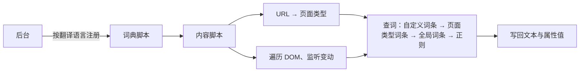

<div align="center">


# GitHub 中文化

把 GitHub 界面翻译成简体中文、繁体中文的浏览器扩展

[](https://github.com/setube/github-chinese/actions/workflows/release.yml)
[](https://github.com/setube/github-chinese/releases)
[](LICENSE)

<br />
[](https://chromewebstore.google.com/detail/github-chinese/bgjbinlidnenibphgepagdkodcohgibe)
[](https://microsoftedge.microsoft.com/addons/detail/ahhkmjnecgfpaegcfpolmlfijmldhmbk)
[](https://addons.mozilla.org/zh-CN/firefox/addon/github-chinese/)
[](#safarimacos)

[安装](#安装) · [功能](#功能) · [使用](#使用) · [工作原理](#工作原理) · [隐私与权限](#隐私与权限) · [参与贡献](#参与贡献) · [反馈问题](https://github.com/setube/github-chinese/issues/new/choose)

</div>

---

在 github.com、gist.github.com、www.githubstatus.com、GitHub 支持站点（help.github.com、support.github.com）及启用的企业版站点上把界面文字替换为简体中文或繁体中文，翻译在本地完成。

只翻译界面，不碰用户内容：自述文件、评论、代码、提交消息、存储库名、用户名、自定义标签名等保持原文。

| 英文界面      | 简体中文 | 繁體中文 |
| ------------- | -------- | -------- |
| Pull requests | 拉取请求 | 拉取請求 |
| Issues        | 议题     | 議題     |
| Actions       | 操作     | 動作     |
| Releases      | 发行版   | 發行版本 |
| Fork          | 复刻     | 分叉     |
| Star          | 星标     | 加星號   |

## 功能

### 翻译

- 简体、繁体两套词典，各 3 万余条，词条按页面类型（存储库、议题、拉取请求、操作、设置等）区分
- 繁体按台湾、香港、澳门用语从英文翻译，不是简繁转换；术语见[简体术语表](docs/GLOSSARY.md)、[繁体术语表](docs/GLOSSARY.zh-TW.md)
- 跟随 GitHub 的 React 渲染与页面切换实时翻译，文字被改写后自动重新翻译
- 属性（`aria-label`、`placeholder`、`title` 等）与标签页标题一并翻译
- 时间本地化：`<relative-time>` 按翻译语言显示为「3 天前」「2026 年 10 月 26 日」，或按自定义格式（如 `YYYY-MM-DD HH:mm`）
- 许可证：许可证文件页横幅、许可证模板选择页、新建存储库页下拉框中的许可证名称、说明与权限、条件、限制标签；许可证正文保持原文
- 支持站点：首页、举报滥用表单、搜索、Copilot 问答的界面

### 加速

- 加速选项：融入 GitHub 原有元素，每个分类一项。Code 下拉框里多出同款的克隆地址行与「Download ZIP [分类]」菜单项，Raw 按钮组里多出同款按钮，发行版附件、标签列表的源码包下方一排小按钮；原链接不变
- 替换原链接：可选一个分类，单击下载链接直接改走它，克隆地址换成加速后的地址；默认不替换
- 下载文件夹：可经加速源取回文件
- 图片：头像、GitHub 静态图片、Raw 图片加载失败时，经加速源重新获取
- 加速源分类：内置分类按提供商划分（共 9 个加速源）；可新建、改名、删除分类，拖动排序，在分类中添加自定义加速源，测速（延迟、Ping）
- 故障转移：用分类中可用的最快的加速源；分类中都不可用时自动隐藏（可按分类关闭）
- 默认关闭

### 搜索净化

- 搜索结果中命中屏蔽规则的结果直接隐藏，不留占位、不提示
- 规则按所有者、存储库、关键词填写；另有内置规则（454 个刷屏、引流的账号），默认开启，可关闭

### 增强

- 自动加载：「加载更多」按钮接近视口时自动点击；有分页的列表滚动到底部时接上下一页，标出页码；按页面逐项开关
- 图片预览：单击正文里的图片（含链到网站的）、文件页的图片，在页面内缩放、拖动、切换，看原图、下载
- 下载次数：发行版附件行显示各附件的下载次数；填个人访问令牌后限额由每个 IP 每小时 60 次提高到每个帐户每小时 5000 次
- 新标签页打开：站外链接、正文链接，以及搜索结果、议题与拉取请求、通知、首页、个人与组织主页、探索页面上的链接，改在新标签页打开；范围逐项开关，另可按路径自定义页面
- 下载文件夹：目录页「添加文件」旁的「下载文件夹」按钮把整个目录打包成 ZIP 下载
- 中文自述文件：存储库首页、目录页的自述文件有中文版（如 `README.zh-CN.md`）时换成中文版，可切回原文
- 下载文件夹默认开启，其余默认关闭

### 企业版

- GitHub Enterprise Server（自有域名）、GHE.com 的站点：启用后与 github.com 相同处理
- 在站点页面的弹出页中授权，或在设置页添加主机名；只申请启用的站点的权限

### 控制

- 弹出页：总开关、当前页状态、排除此页、时间本地化、翻译标题、加速下载、净化搜索、自动加载、图片预览、下载次数、下载文件夹、新标签页打开、中文自述文件、界面语言、翻译语言、外观
- 设置页（弹出页「设置」）分七个标签页：汉化设置（排除路径；自定义词库、内置词库）、加速设置（加速开关、替换原链接、加速源分类）、净化设置（净化搜索开关；自定义规则、内置规则）、自动加载设置（自动加载开关、范围）、下载次数设置（下载次数开关、说明、个人访问令牌）、新标签页设置（新标签页打开开关、范围、自定义页面）、企业版设置（企业版站点）；改动即时保存
- 反馈：设置页顶部「反馈问题」在新窗口打开新建议题的模板选择页
- 列表（排除路径、自定义词库、加速源、屏蔽规则、新标签页的自定义页面、企业版站点）可多选、全选，删除所选（需确认）；列表向下滚动后右下角有返回顶部按钮
- 设置备份：设置页顶部导出、导入全部设置；排除路径、加速源、净化设置、下载次数设置、新标签页设置、企业版设置可单独导出、导入
- 翻译语言默认按浏览器语言识别（语言列表中第一个中文：台湾、香港、澳门及 Hant 为繁体；没有中文时按时区），可手动指定；切换后已打开的页面随即重译
- 扩展界面：简体中文、繁體中文、English，默认跟随浏览器界面语言
- 外观：自动（跟随系统）、浅色、深色
- 新版本提示：从发行版安装的 Chrome、Edge、Safari 版，弹出页与设置页的版本号后显示「新版本」，链到该版本的发行版页；商店安装、企业策略部署的与 Firefox 版不检查

## 安装

### 从扩展商店安装

| 浏览器  | 商店                                                                                                        |
| ------- | ----------------------------------------------------------------------------------------------------------- |
| Chrome  | [Chrome 应用商店](https://chromewebstore.google.com/detail/github-chinese/bgjbinlidnenibphgepagdkodcohgibe) |
| Edge    | [Microsoft Edge 加载项](https://microsoftedge.microsoft.com/addons/detail/ahhkmjnecgfpaegcfpolmlfijmldhmbk) |
| Firefox | [Firefox 附加组件](https://addons.mozilla.org/zh-CN/firefox/addon/github-chinese/)                          |

### 从发行版安装

在[发行版](https://github.com/setube/github-chinese/releases)页面下载：

| 浏览器  | 文件                                | 安装                                                                                                                   |
| ------- | ----------------------------------- | ---------------------------------------------------------------------------------------------------------------------- |
| Chrome  | `github-chinese-<版本>-chrome.zip`  | 解压 → `chrome://extensions` → 开启「开发者模式」→「加载已解压的扩展程序」→ 选择解压出的文件夹                         |
| Edge    | `github-chinese-<版本>-edge.zip`    | 解压 → `edge://extensions` → 开启「开发人员模式」→「加载解压缩的扩展」→ 选择解压出的文件夹                             |
| Firefox | `github-chinese-<版本>-firefox.xpi` | 已签名：用 Firefox 打开即安装。未签名：`about:debugging#/runtime/this-firefox` →「临时载入附加组件」，重启浏览器后失效 |

- `.crx` 用于企业策略部署；Chrome、Edge 一般不允许直接安装商店之外的 crx。
- 更新 Chrome、Edge 版：用新版文件覆盖原文件夹，在扩展页点「重新加载」。解压到新文件夹再加载会多出一个扩展，设置与自定义词库不随迁。
- 校验：`sha256sum -c --ignore-missing SHA256SUMS.txt`

### Safari（macOS）

未上架 App Store；宿主应用未签名、未经公证。需要 macOS 13+、Safari 18+。

1. 下载 `github-chinese-<版本>-safari-macos.zip`，解压，把「GitHub Chinese.app」移到「应用程序」。
2. 解除隔离（未公证的应用默认打不开）：

   ```bash
   xattr -dr com.apple.quarantine "/Applications/GitHub Chinese.app"
   ```

3. 打开「GitHub Chinese」一次，扩展随之注册到 Safari。
4. Safari「设置」→「高级」→ 勾选「显示网页开发者功能」；「开发者」→ 勾选「允许未签名的扩展」。
5. 「设置」→「扩展」→ 勾选「GitHub 中文化」；「编辑网站…」中允许 github.com、gist.github.com、www.githubstatus.com、help.github.com、support.github.com。

- 「允许未签名的扩展」在退出 Safari 后失效，每次启动 Safari 需重新勾选。
- 更新：用新版替换「应用程序」中的旧版，重做第 2、3 步。

### 从源码构建

环境：Bun 1.3+、Node.js 22.13+（LTS 版本）。

```bash
git clone https://github.com/setube/github-chinese.git
cd github-chinese
bun install
bun run build           # Chrome → .output/chrome-mv3
bun run build:edge      # Edge → .output/edge-mv3
bun run build:firefox   # Firefox → .output/firefox-mv3
bun run build:safari    # Safari → .output/safari-mv3
bun run pack:safari     # 由 .output/safari-mv3 打包宿主应用（macOS，需 Xcode）→ .output/github-chinese-<版本>-safari-macos.zip
```

加载方式同上表（不用解压）；Firefox 临时载入 `.output/firefox-mv3/manifest.json`。

## 使用

安装后立即生效，已打开的 GitHub 页面无需刷新。

### 弹出页状态

| 状态   | 含义                                         | 按钮     |
| ------ | -------------------------------------------- | -------- |
| 已翻译 | 当前页已翻译                                 | 排除此页 |
| 已排除 | 当前页命中排除规则                           | 取消排除 |
| 已停用 | 总开关关闭                                   | —        |
| 未就绪 | 页面里的脚本未响应                           | 刷新     |
| 未授权 | 站点权限已撤销，或当前页是未启用的企业版站点 | 授权     |
| 不可用 | 当前页不是 GitHub 页面                       | —        |

### 时间格式

设置页「汉化设置」的「时间格式」：「默认」按翻译语言显示（3 天前、2026 年 10 月 26 日）；「自定义」按输入的格式显示具体时刻，旁边显示按格式写出的当前时间。

- 需开启「时间本地化」；时长（操作的运行用时等）不按格式。
- 格式为空时同「默认」。
- 记号同 Day.js，其余字符原样显示：

| 记号                  | 含义            | 示例（2026-01-05 周一 09:03:07）  |
| --------------------- | --------------- | --------------------------------- |
| `YYYY` `YY`           | 年              | 2026、26                          |
| `M` `MM`              | 月              | 1、01                             |
| `MMM` `MMMM`          | 月              | 1月、一月                         |
| `D` `DD`              | 日              | 5、05                             |
| `d` `dd` `ddd` `dddd` | 星期            | 1、一、周一（繁体为週一）、星期一 |
| `H` `HH`              | 时（24 小时制） | 9、09                             |
| `h` `hh`              | 时（12 小时制） | 9、09                             |
| `A` `a`               | 上午、下午      | 上午                              |
| `m` `mm`              | 分              | 3、03                             |
| `s` `ss`              | 秒              | 7、07                             |
| `SSS`                 | 毫秒            | 000                               |
| `Z` `ZZ`              | 与 UTC 的偏移   | +08:00、+0800                     |
| `[]`                  | 原样显示        | `[第]` → 第                       |

### 排除路径

弹出页「排除此页」加入当前页的路径；设置页「汉化设置」中逐条添加、修改、删除，可多选删除，可单独导入、导出。

每条以 `/` 开头，不区分大小写；`*` 匹配一段，`**` 匹配任意多段；同时排除下级路径。

```text
/settings        设置页及其下级页面
/*/*/wiki        所有存储库的维基
```

- 只停止翻译；加速、搜索净化照常。
- 弹出页「取消排除」删除命中当前页的全部规则，含通配规则。

### 企业版站点

GitHub Enterprise Server（如 `github.example.com`）、GHE.com（如 `octo-corp.ghe.com`）的页面与 github.com 相同，启用后照常翻译：

- 在该站点的页面打开弹出页，状态为「未授权」时点「授权」，在浏览器的询问中允许；已打开的该站页面随即翻译。
- 或在设置页「企业版设置」中添加主机名（可粘贴地址）；删除时撤销该站点的权限。
- 每个站点申请主站与 `gist.` 子域名两项（GHES 开启子域名隔离时代码片段所在）；未开启子域名隔离时，主站 `/gist` 下的代码片段页同样识别。
- 弹出页按页面头部的 GitHub 标记识别企业版站点；识别不到时在设置页添加。
- 加速只处理 github.com 的地址；企业版站点页面上指向 github.com 的链接照常加速。

### 自定义词库

设置页「汉化设置」的「自定义词库」中添加、搜索、修改、删除，可多选删除。原文 → 译文，优先于内置词条。导入、导出格式为 JSON：`{ "原文": "译文" }`；导入时同一原文以导入的为准。

### 内置词库

设置页「汉化设置」的「内置词库」列出内置词条：原文、译文、范围（全局，或生效的页面类型）。

- 默认为当前翻译语言，可切换；第一次打开这个标签页时才加载。
- 搜索原文、译文、页面类型，不区分大小写；空格分隔的多个词都要命中。
- 正则、行内句规则显示其写法；译文按匹配结果生成的显示为「—」。

### 加速

「加速下载」（弹出页、设置页）管下载、克隆与下载文件夹；设置页「加速设置」另有「加速图片」「故障转移」开关、「替换原链接」与加速源分类。

| 内置分类 | 加速源                                                                |
| -------- | --------------------------------------------------------------------- |
| gh-proxy | hk.gh-proxy.org、cdn.gh-proxy.org、edgeone.gh-proxy.org、gh-proxy.com |
| ghfast   | ghfast.top                                                            |
| wget.la  | wget.la                                                               |
| 其他     | gh.monlor.com、hub.ddayh.com、ghproxy.053000.xyz                      |
| 自定义   | 默认为空；旧版本添加的自定义加速源归入其中                            |

- 分类：每个分类一个标签，标签上为加速源个数。「+」新建分类，名称框中改名，「删除分类」连同其中的自定义加速源删除；「测速」测全部加速源，「恢复内置」找回删除的内置分类与加速源。加速源添加到选中的分类，可多选删除。
- 分类顺序：拖动标签（触屏长按后拖动），或聚焦标签按 `Alt` + `←` `→`；页面上的加速选项、下载文件夹的菜单随即换序。
- 加速选项：每个分类一项，没有支持该地址的加速源的分类不列出；链接单击下载，右键可复制地址。
  - 存储库「Code」下拉框：HTTPS 克隆地址下方加同款的地址行，单击地址框或复制按钮即复制加速后的地址；Download ZIP 下方加「Download ZIP [分类]」菜单项。下拉框变高后限高，内部滚动。
  - 文件页：Raw 所在按钮组里、Raw 之后加各分类的按钮，新标签页打开。
  - 代码片段：Raw、Download ZIP 按钮之后加各分类的按钮，与原按钮拼成一组；窄屏菜单的 Download ZIP 同 Code 下拉框。
  - 发行版的附件、源码包，标签列表的 zip、tar.gz：下方一排小按钮。
- 替换原链接：选一个分类后，单击下载链接改开该分类加速后的地址，中键、带修饰键的单击照常从 GitHub 打开；存储库「Code」下拉框与代码片段的 HTTPS 克隆地址换成加速后的地址，复制按钮复制加速后的地址。新建存储库页面中的地址不改。
- 下载文件夹：目录页「下载文件夹」按钮的菜单中，「直连」之后列出各分类，文件经该分类的加速源取回。
- 图片：开启「加速图片」后，头像、GitHub 静态图片、Raw 图片加载失败时由后台经加速源获取，换成 `data:` 地址显示。
- 故障转移关闭时，用分类中第一个支持该地址的加速源；图片只试第一个支持的。
- 故障转移开启时，后台探测各加速源，用分类中可用、耗时最短的；结果 5 分钟内有效（不可用的 1 分钟），存在 `storage.session`，浏览器关闭时清除。分类中都不可用时，开着「自动隐藏」的分类不列出，关着的列为不可用；替换原链接时打开原链接、克隆地址不改。图片按耗时从短到长逐个尝试。
- 私有、内部存储库与私密代码片段的页面不加速。
- 页面的 CSS、JS 不加速：GitHub 的内容安全策略只允许从 `github.githubassets.com` 加载脚本与样式，换地址或重定向都会被浏览器拦截。

加速源地址只接受 `https`：`{url}` 换成原链接，`{path}` 换成 github.com 上的路径；都不写时原链接接在地址之后。

```text
https://ghfast.top/{url}        https://ghfast.top/https://github.com/<所有者>/<存储库>/releases/download/…
https://mirror.example/{path}   https://mirror.example/<所有者>/<存储库>/releases/download/…
https://ghfast.top              同第一行
```

- 用 `{path}` 的加速源只加速 github.com 上的地址。各内置加速源支持的地址不同，分类中第一个不支持时用下一个支持的。
- 延迟：首次请求的耗时，含建立连接；Ping：连接建立后再请求 3 次的中位数。浏览器发不了 ICMP，两者都按 HTTP 请求计时。
- 内置加速源是第三方公益服务，可用性随时变化。加速源能看到下载地址与你的 IP 地址，也能改动下载的文件。
- 用加速地址克隆的存储库，远程地址指向加速源，推送时凭据会发给加速源。推送前改回 GitHub：`git remote set-url origin https://github.com/<所有者>/<存储库>.git`。

### 搜索净化

设置页「净化设置」的「自定义规则」中逐条添加、修改、删除，可多选删除，不区分大小写：

```text
@octocat               所有者：其存储库、存储库下的议题与代码等结果，以及该用户本身
octocat/hello-world    存储库
hello world            关键词：名称、标题、描述、主题、标签含这段文字
```

- GitHub 地址按所有者、存储库识别，存为上面的写法：`https://github.com/octocat`、`https://github.com/octocat/hello-world/issues`。
- 其余写法都按关键词。不带 `@` 的用户名也是关键词，会命中名称里含它的其他结果。以 `@` 开头、写成「所有者/存储库」的关键词加引号：`"@octocat"`。
- 指向同一所有者、存储库或关键词（关键词加不加引号）的规则不重复添加。
- 只处理 github.com 的搜索结果页。结果数、分页不变；一页全部命中时该页为空。
- 内置规则：454 个在搜索结果中刷屏、引流的账号（所有者写法），收录自 [Github搜索净化](https://github.com/BonjourFeng/Github-Search-Purification) 的默认屏蔽名单；「内置规则」中浏览、搜索，可关闭，默认开启。
- 总开关或「净化搜索」（弹出页、设置页）关闭后不再隐藏。改规则、开关后已打开的搜索页随即更新，无需刷新。

### 增强

弹出页中开关；自动加载、新标签页打开另在设置页对应的标签页（自动加载设置、新标签页设置）中开关，并设置范围与自定义页面。

#### 自动加载

- 「加载更多」按钮（首页动态与侧栏、贡献动态、主题页、议题与拉取请求里折叠的时间线、导航侧栏的常用存储库等）接近视口时点击。
- 分页列表：列表底部的分页接近视口时取回下一页，列表项接在当前列表之后，直到最后一页。有分页的列表都处理，如议题、拉取请求、搜索结果、讨论、操作、发行版、标签、提交、分支、复刻、个人主页（存储库、星标、关注者）、组织存储库、代码片段、市场、MCP 注册表。
- 页码：每页前插入「第 N 页」，链接到该页；底部分页换成最后接上的那一页的。
- 接上的项是 GitHub 服务端渲染的内容：链接可用；由 GitHub 前端加载的部分（提交的验证、检查状态等）不显示，其中的按钮（复制、展开说明等）不响应。
- 同一页面最多接上 30 页；取不到时停在当前页，分页留给手动翻页。
- 范围：设置页「自动加载设置」中按页面逐项开关，默认全部开启。

| 范围           | 页面                                                                                                                   |
| -------------- | ---------------------------------------------------------------------------------------------------------------------- |
| 搜索结果       | 站内搜索、代码片段搜索                                                                                                 |
| 议题           | 议题列表与详情（时间线）、标签与里程碑页、全局议题页                                                                   |
| 拉取请求       | 拉取请求列表与详情（时间线）、全局拉取请求页                                                                           |
| 讨论           | 存储库、组织的讨论列表与详情，全局讨论页                                                                               |
| 操作           | 工作流运行列表                                                                                                         |
| 发行版         | 发行版列表                                                                                                             |
| 标签           | 标签列表                                                                                                               |
| 提交           | 提交历史                                                                                                               |
| 首页           | 首页动态与侧栏                                                                                                         |
| 个人与组织主页 | 个人主页（贡献动态、存储库、星标、关注者）、组织主页与组织下的列表，我的存储库、关注的存储库、星标列表，个人的代码片段 |
| 侧栏常用存储库 | 全局导航侧栏的常用存储库，任何页面                                                                                     |
| 其他页面       | 以上之外，如分支、复刻、主题、市场、MCP 注册表、通知                                                                   |

#### 图片预览

- 单击正文（自述文件、评论、发行说明、维基、讨论等）里的图片，或文件页显示的图片打开；表情、头像、加载失败的不处理。
- 图片链到别处（如横幅链到网站）时同样打开，预览中可「打开链接」。
- 徽章、图标不打开，单击照常：地址含 badge、shields；显示不超过 32×32；显示高度不超过 32 且原图不超过显示的两倍高。有没有链接都一样。
- 页面上其余可预览的正文图片可切换。
- 滚轮、双指缩放，拖动平移，双击在适应窗口与原始大小间切换；单击图片以外的地方关闭。
- 按键：`←` `→` 切换，`+` `-` 缩放，`0` 重置，`Esc` 关闭。
- 打开链接、原图：新标签页打开。下载：保存该图片，取不到时改为新标签页打开。
- 中键、带修饰键的单击照常。

#### 新标签页打开

开启后，单击下列范围中的链接改在新标签页打开：

| 范围                                                       | 生效的链接                                       |
| ---------------------------------------------------------- | ------------------------------------------------ |
| 站外链接                                                   | 任何页面上指向 GitHub 以外站点的                 |
| 正文链接                                                   | 任何页面上正文（自述文件、评论等）里的           |
| 搜索结果、议题与拉取请求、通知、首页、个人与组织主页、探索 | 这些页面的主体中的；顶栏、导航、菜单、分页等除外 |
| 自定义页面                                                 | 路径匹配的页面的主体中的                         |

- 默认开启站外链接、搜索结果两项；总开关默认关闭。
- 自定义页面写法同排除路径：`/*/*/releases` 为所有存储库的发行版页及其下级页面；可多选删除，可单独导入、导出（连同范围与开关）。
- 不处理：只改当前页查询串、锚点的（筛选、排序、翻页、页内跳转），本来就在新窗口打开的，下载链接，作按钮用的链接；中键、带修饰键的单击照常。
- 开启「加速下载」并替换原链接时，下载链接仍在当前页打开加速地址。

#### 下载文件夹

目录页顶栏「添加文件」之后的「下载文件夹」按钮把当前目录（含子目录）在本地打包成 ZIP 保存，窄屏只显示图标；进度显示在页面右下角，可取消。

- 文件经 GitHub 自己的接口取回（同站带 Cookie），私有存储库、企业版站点同样可用；下载期间分支有新提交时仍取同一版本。
- 上限：1000 个文件、300 个目录、共 500 MB，超出时不下载。
- 开启「加速下载」、github.com 上的公开存储库：按钮带菜单，可选经加速分类取回（见[加速](#加速)），不带 Cookie。

#### 下载次数

发行版列表与单个发行版页面的附件行，附件名一侧靠右显示下载次数；大数按界面语言缩写（如 1.2万），悬停显示完整次数。

- 次数取自 GitHub REST API（`api.github.com`），由扩展后台请求，不带 Cookie 与来源页。
- 未填令牌：每个 IP 每小时 60 次，与同一网络下其他未登录的 API 请求共用；用尽后到重置时间之前不显示。
- 填了个人访问令牌：每个帐户每小时 5000 次，同一帐户的令牌、授权的应用共用。在设置页「下载次数设置」中填写，下方显示剩余额度；令牌只存在本机（`storage.local`），不同步，只发给 `api.github.com`。
- 创建令牌：新建精细个人访问令牌（fine-grained），存储库访问权限选「公共存储库」，不添加权限。设置页中有链接与步骤。
- 「下载次数设置」的「导出」含令牌，设置页顶部的完整备份不含；导入完整备份不改令牌。
- 打开、刷新发行版页面时请求，同时只发一个；同一发行版 10 分钟内不重复请求（页面与后台各缓存 10 分钟）。
- 设置页「下载次数设置」的「说明」列出次数来源、更新方式与额度。
- 只处理 github.com 上的公开存储库。

#### 中文自述文件

存储库首页（「自述文件」标签页）与目录页上的自述文件有中文版时，换成中文版，上方显示「已切换到中文版 <文件> · 显示原文」。

- 中文版按路径认：GitHub 能渲染的标记语言文件（`.md`、`.rst` 等），文件名带中文的语言标记，如 `README.zh-CN.md`、`README_CN.md`、`README-zh_Hant.md`、`README.Chinese.md`；或是中文语言目录里的自述文件，如 `docs/zh-CN/README.md`。
- 从自述文件里的链接与目录的文件列表里找；链接指向别的目录时，链接文字、提示或图片的替代文字要是语言名（简体中文、中文、Chinese、zh-CN 等）。
- 有多个时依次取：简繁与翻译语言相同的、同一目录的、先出现的。
- 显示的自述文件本来就是中文时不换。
- 「显示原文」后，本页面内（含站内跳转）这个存储库保持原文，可点「显示中文版」换回。
- 中文版是 GitHub 渲染好的正文：向同站请求该文件的页面数据（带 Cookie，同在页面上浏览），本页面内最近取过的 20 个不再取；取不到（正文过长被截断、请求失败等）时保持原文，不提示。
- 新出现的自述文件在中文版取回之前先不显示（最多 2 秒），不先显示原文再换。
- 自述文件上方的大纲、编辑按钮仍对应原文。

### 设置备份

设置页顶部「导出备份」把设置、自定义词库、屏蔽规则、已启用的企业版站点存为一个 JSON 文件；「导入备份」读回。

- 设置按文件覆盖，只覆盖文件中有的项；排除路径、新标签页的自定义页面、自定义词库、屏蔽规则与现有的合并，同一原文以导入的为准。
- 企业版站点要授权：导入后在「企业版设置」中列为待授权，点「授权」并在浏览器的询问中允许。
- 排除路径、加速源、净化设置、下载次数设置、新标签页设置、企业版设置各有「导入」「导出」，只含该部分；导入完整备份时只取该部分。加速源的「导入」「导出」在「加速源」标题旁，含加速下载、图片加速、故障转移三个开关，分类及其顺序、加速源、替换原链接所选的分类；导入时开关只改文件中有的。

## 工作原理



- **词典脚本**：每种翻译语言一个，只加载当前语言的。后台把它注册为 `document_start` 内容脚本，页面开始解析前就绪；未注册时（如刚安装）由内容脚本动态导入，Firefox、Safari 请后台注入。
- **与 React 共存**：只改文本节点的内容与属性值，不增删、替换节点；React 重渲染写回英文时，以新内容为原文重新翻译。
- **跳过用户内容**：用户内容、代码所在的区域整体跳过。
- **时间本地化**：`<relative-time>` 等时间元素按翻译语言渲染，再补中文与数字间的空格、去掉时区名；选了自定义格式时，元素每次渲染后把显示文字换成按格式写出的时刻。
- **搜索净化**：随页面变动逐条检查搜索结果，命中规则的结果改行内 `display`，不删节点；变动回调在绘制前执行，命中的结果不会先显示再消失。

## 浏览器支持

| 浏览器          | 版本                    |
| --------------- | ----------------------- |
| Chrome、Edge    | 支持 Manifest V3 的版本 |
| Firefox         | 128+                    |
| Firefox Android | 128+                    |
| Safari（macOS） | 18+                     |

## 隐私与权限

翻译、搜索净化在本地完成，不向开发者发送数据。开启「下载次数」后，发行版附件所属的存储库与标签发给 GitHub API 以取次数；填了个人访问令牌时一并发给 GitHub API（只发给 `api.github.com`，令牌只存在本机）。开启加速后，经加速选项或替换原链接打开、复制的下载链接与克隆地址，经加速源下载的文件夹中的文件，加载失败的图片地址，交给相应的第三方加速源。详见[隐私说明](docs/PRIVACY.md)。

| 权限                                                                                                                                               | 用途                                                                                                                                                                                                                              |
| -------------------------------------------------------------------------------------------------------------------------------------------------- | --------------------------------------------------------------------------------------------------------------------------------------------------------------------------------------------------------------------------------- |
| `storage`                                                                                                                                          | 保存设置（`storage.sync`）、自定义词库、屏蔽规则与个人访问令牌（`storage.local`）、加速源的探测结果（`storage.session`）                                                                                                          |
| `https://github.com/*`、`https://gist.github.com/*`、`https://www.githubstatus.com/*`、`https://help.github.com/*`、`https://support.github.com/*` | 在这五个站点运行内容脚本，翻译页面界面；检查新版本时读取 github.com 上最新发行版的地址                                                                                                                                            |
| `scripting`                                                                                                                                        | 按当前语言注册词典脚本，页面开始解析前就绪；词典脚本动态加载失败（Firefox、Safari 不动态加载）时由后台注入；Chrome、Edge、Safari 安装、更新后向已打开的 GitHub 标签页注入脚本（Firefox 自动注入）；为启用的企业版站点注册内容脚本 |
| `activeTab`                                                                                                                                        | 打开弹出页时读取当前页的地址，查看页面头部有无 GitHub 的标记，识别未启用的企业版站点                                                                                                                                              |
| `*://*/*`（可选）                                                                                                                                  | 安装、更新时不申请；启用企业版站点时只申请该站点（主站与 `gist.` 子域名），在该站点运行内容脚本                                                                                                                                   |

- 不申请其他权限。Firefox 中可在附加组件管理器撤销站点权限，撤销后弹出页显示「未授权」，点「授权」恢复。Safari 中站点权限在「设置」→「扩展」中授予、撤销。
- 企业版站点的权限在设置页「企业版设置」中删除，或在浏览器的扩展管理中撤销；撤销后该站点不再运行脚本。
- 停用、排除、改自定义词条、改时间本地化开关、扩展更新或卸载时，以及 GitHub 从自身缓存写回译文时（前进后退、帧导航到带锚点的地址），可能重新请求当前 GitHub 页面（条件见隐私说明）；点弹出页「刷新」时重新加载当前页。开启加速后：单击加速选项，或替换原链接时单击下载链接，打开加速源的地址；经加速分类下载文件夹时向加速源请求其中的文件；开启「加速图片」时，图片加载失败后由后台经加速源请求该图片；故障转移开启时，页面上有可加速的链接、克隆地址，或打开「下载文件夹」按钮的菜单时，由后台请求各加速源站点的根路径探测能否连通；设置页「测速」时请求各加速源站点的根路径。下载文件夹时请求该目录及子目录的页面数据与其中的文件（同站带 Cookie）。开启「自动加载」时，分页接近视口后请求同站的下一页（带 Cookie，同手动翻页），「加载更多」按钮由 GitHub 自身请求。图片预览中点「下载」时重新请求该图片（同站带 Cookie，跨站不带）。开启「下载次数」时，页面上出现公开存储库的发行版附件后由后台向 `api.github.com` 请求该发行版（不带 Cookie 与来源页；填了个人访问令牌时带上令牌）；设置页「下载次数设置」打开时请求 `api.github.com` 的 `/rate_limit` 查剩余额度。开启「中文自述文件」时，存储库首页、目录页的自述文件有中文版时请求该文件的页面数据（同站带 Cookie，同在页面上浏览）。从发行版安装的 Chrome、Edge、Safari 版，打开弹出页或设置页时，距上次检查满 24 小时则请求 github.com 上本项目的最新发行版地址（HEAD，不带 Cookie）。不发起其他网络请求。
- 设置存 `storage.sync`，可能随浏览器账号同步（Safari 不同步）；自定义词库、屏蔽规则与个人访问令牌存 `storage.local`（令牌不同步）；加速源的探测结果存 `storage.session`，浏览器关闭时清除。

## 参与贡献

流程与约定见[贡献指南](CONTRIBUTING.md)；参与即表示遵守[行为准则](CODE_OF_CONDUCT.md)；安全漏洞按[安全政策](SECURITY.md)私下报告。

- 反馈：[新建议题](https://github.com/setube/github-chinese/issues/new/choose)，选「翻译问题」「缺陷报告」或「功能建议」模板。
- 改进译文：先读[术语表](docs/GLOSSARY.md)；改动简体词典后同步繁体。
- 提交前运行以下检查（同[发布工作流](.github/workflows/release.yml)）：

```bash
bun run lint
bun run compile
bun run check:parity
bun run check:locale
bun run check:locale --locale=zh-TW
bun run test
```

### 常用命令

| 命令                                                                        | 说明                                                                               |
| --------------------------------------------------------------------------- | ---------------------------------------------------------------------------------- |
| `bun run dev`、`dev:edge`、`dev:firefox`                                    | 开发模式，修改后自动重载                                                           |
| `bun run build`、`build:edge`、`build:firefox`、`build:safari`、`build:all` | 构建到 `.output/<浏览器>-mv3/`                                                     |
| `bun run zip`、`zip:edge`、`zip:firefox`、`zip:all`                         | 打包 zip 到 `.output/`（Firefox 另出源码包）                                       |
| `bun run pack:crx`                                                          | 由 zip 打包 crx                                                                    |
| `bun run pack:safari`                                                       | 由 Safari 版打包宿主应用（macOS，需 Xcode）                                        |
| `bun run test`、`test:watch`、`coverage`                                    | 单元测试（Vitest）、监听模式、覆盖率                                               |
| `bun run test:e2e`、`test:e2e:live`                                         | 端到端测试（Playwright）、线上冒烟，均先构建                                       |
| `bun run compile`、`lint`、`lint:firefox`、`format`                         | 类型检查（vue-tsc）、ESLint、web-ext lint、Prettier                                |
| `bun run check:locale`、`check:parity`                                      | 词典自检、简繁对照                                                                 |
| `bun run harvest`、`coverage:locale`                                        | 采集界面文本、统计词典覆盖率                                                       |
| `bun run icons`                                                             | 由 `assets/icon.svg` 生成 `public/icon/*.png`（内嵌位图超过 512px 时先压缩并写回） |

`bun test`、`bun build` 是 Bun 自带命令，本项目脚本一律用 `bun run`。

<details>
<summary><b>词典维护</b></summary>

1. 先读[术语表](docs/GLOSSARY.md)：翻译原则、格式、术语表、词典写法。术语参照 GitHub 官方中文文档与 Pro Git 中文版；社区词库 [maboloshi/github-chinese](https://github.com/maboloshi/github-chinese)（GPL-3.0）只用于发现漏收的原文，不搬运译文。
2. 简体词典在 `src/locales/zh-CN/`，繁体词典在 `src/locales/zh-TW/`（同名文件、同键同结构，译文按[繁体术语表](docs/GLOSSARY.zh-TW.md)从英文翻译），按页面类型分文件（`static` / `scoped` / `regexp` / `ignore` / `attributeRules` / `inline` / `mergeText`，字段说明见 `src/core/types.ts`），由 `index.ts` 注册。较大的组拆成子目录 `<组>/<名>.ts`，由 `<组>.ts` 用 `mergeDictionaries` 合并；子目录里没有默认导出的模块是共用工具。
3. 自检：`bun run check:locale src/locales/zh-CN/<文件>.ts`；不带文件时检查全部词典（含子文件），另查 static 冲突、同一页面类型的 scoped 冲突、未合并的子文件、未注册的主文件；加 `--redundant` 列出可删的 scoped（全局 static 已有相同译文）。繁体加 `--locale=zh-TW`（给出 `src/locales/zh-TW/` 下的文件时可省略），另扫描源码里所有含中文的字符串与模板字面量（含替换函数、模块内常量、helpers.ts 与 `src/locales/shared/`；注释与抛出的错误信息除外）：简体字报错，大陆用语与弯引号警告。改动简体词典后同步繁体，`bun run check:parity [文件...]` 逐项对照两边的键、正则、属性规则、行内句、导出与注册顺序。
4. 采集界面文本：`bun run harvest [--areas issues,pulls]`，按 `scripts/harvest-urls.json` 访问公开页面（未登录），输出 `.harvest/raw/<区域>.json`。访问要克制，避免触发限流。
5. 统计覆盖率：`bun run coverage:locale [--raw <目录>]... [--all] [--unused]`，输出 `.harvest/digest/<区域>.txt`（未翻译文本，按出现页面数排序）与 `coverage.json`；页面类型按当前路由规则重新判断，相邻文本节点与引擎一样先整组匹配、未命中再逐段统计（需用新版 harvest 采集的数据）。`--unused` 另输出 `unused.txt`：采集页面上从未用到的词条，可能已过时，删除前人工核对。
6. 正则规则写单元测试：`tests/unit/locales/<区域>.test.ts`。

</details>

<details>
<summary><b>测试</b></summary>

```bash
bun run test            # 单元测试（Vitest）
bun run coverage        # 单元测试覆盖率
bun run test:e2e        # 构建后运行端到端测试（Playwright 加载 .output/chrome-mv3）
bun run test:e2e:live   # 线上冒烟：访问 github.com/vuejs/core，截图存 test-results/
```

端到端测试首次运行前安装浏览器：`bunx playwright install chromium`。

- 离线测试：`github.com` 请求由 `tests/e2e/fixtures/` 中仿 GitHub 结构的页面应答，覆盖界面翻译、用户内容保持原文、属性、动态插入与 React 改写、忽略区域内的界面块（评论中的建议块、应用权限选择器）、`<relative-time>`、标题、设置联动（总开关、排除路径、自定义词条，含后台休眠后）、弹出页。
- 线上冒烟仅在环境变量 `E2E_LIVE=1` 时执行，`bun run test:e2e:live` 已自动设置。
- 报告：`playwright-report/`；失败时的 trace 与截图：`test-results/`。

</details>

<details>
<summary><b>目录结构</b></summary>

```text
.github/                 议题模板、发布工作流
assets/icon.svg          图标源文件
docs/GLOSSARY.md         翻译规范与术语表
docs/GLOSSARY.zh-TW.md   繁体翻译规范与术语表
docs/PRIVACY.md          隐私说明
public/_locales/         扩展名称、说明的多语言文本
public/icon/             扩展图标（bun run icons 生成）
scripts/                 采集、覆盖率、词典校验、图标渲染、crx 与 Safari 打包脚本
scripts/safari-app/      Safari 宿主应用的页面
src/
  core/                  匹配器、URL → 页面类型、忽略规则、翻译引擎、加速、搜索净化、增强（自动加载、图片预览、新标签页打开、下载次数、中文自述文件）
  locales/zh-CN/         简体中文词典
  locales/zh-TW/         繁体中文词典（与简体同结构）
  locales/shared/        简繁共用的时间、拼接工具
  i18n/                  扩展界面文案（简体、繁体、英文）
  shared/                设置存储、消息协议、企业版站点与脚本注册等共用模块
  components/            弹出页与设置页共用组件
  components/ui/         基础控件：按钮（含水波纹）、输入框、下拉框、开关、标签页
  entrypoints/           background、content、词典脚本、popup、options
tests/
  unit/                  单元测试
  e2e/                   端到端测试与离线夹具
CONTRIBUTING.md          贡献指南
CODE_OF_CONDUCT.md       行为准则
SECURITY.md              安全政策
wxt.config.ts            WXT 配置与 manifest
```

</details>

## 发布

推送标签 `v<版本>`（与 `package.json` 的 `version` 一致）后，[发布工作流](.github/workflows/release.yml)依次检查（lint、类型、词典、单元测试）、打包，并发布 GitHub 发行版（先建草稿，产物传完后发布）；Safari 版同时在 macOS 上打包，打包失败时发行版不含 Safari 版；版本号带 `-`（如 `v1.0.0-beta.1`）时为预发行版。在存储库的「操作」页手动运行时只检查、打包，产物在运行记录的工件里。

| 产物                                                | 说明                                                    |
| --------------------------------------------------- | ------------------------------------------------------- |
| `github-chinese-<版本>-chrome.zip`、`-edge.zip`     | Chrome、Edge 扩展包（上架商店用）                       |
| `github-chinese-<版本>-firefox.zip`、`-sources.zip` | Firefox 扩展包、源码包（AMO 审核用）                    |
| `github-chinese-<版本>-chrome.crx`、`-edge.crx`     | CRX3 扩展包                                             |
| `github-chinese-<版本>-firefox.xpi`                 | Firefox 扩展包                                          |
| `github-chinese-<版本>-safari-macos.zip`            | Safari 宿主应用（未签名、未公证）                       |
| `SHA256SUMS.txt`                                    | 以上文件的 SHA-256，校验：`sha256sum -c SHA256SUMS.txt` |

<details>
<summary><b>存储库机密与签名</b></summary>

| 机密                               | 用途                                                                                                     | 未配置时                     |
| ---------------------------------- | -------------------------------------------------------------------------------------------------------- | ---------------------------- |
| `CRX_PRIVATE_KEY`                  | crx 签名私钥（RSA PEM），决定扩展 ID                                                                     | 用临时私钥，扩展 ID 每次不同 |
| `AMO_JWT_ISSUER`、`AMO_JWT_SECRET` | [AMO API 密钥](https://addons.mozilla.org/developers/addon/api/key/)，以自行分发（unlisted）方式签名 xpi | xpi 未签名                   |

- 生成私钥：`openssl genpkey -algorithm RSA -pkeyopt rsa_keygen_bits:2048 -out crx-key.pem`，文件内容填入 `CRX_PRIVATE_KEY`。私钥不提交到存储库（`.gitignore` 已忽略 `*.pem`）；更换私钥后扩展 ID 随之改变。
- 本地打包 crx：`bun run pack:crx --key crx-key.pem .output/github-chinese-<版本>-chrome.zip`，在 zip 旁生成同名 `.crx`；不带 `--key` 时读环境变量 `CRX_PRIVATE_KEY`。
- xpi 只在推送正式版标签时签名；手动运行、预发行版（Firefox 的版本号去掉 `-` 之后的部分，签名会占用正式版的版本号）产出未签名 xpi。
- AMO 上同一版本号只能提交一次：签名包下载后立即存进发行版草稿，重跑时沿用；以 unlisted 签名过的版本，不能再以同一版本号上架（listed）。

</details>

## 常见问题

### 有些文字没有翻译？

用户内容不翻译。界面文字未翻译时，用「翻译问题」模板反馈。

### 繁体是简繁转换吗？

不是。繁体词典按台湾、香港、澳门用语从英文翻译，见[繁体术语表](docs/GLOSSARY.zh-TW.md)。

### 企业版（自有域名）能用吗？

能。见[企业版站点](#企业版站点)。

### 只在部分页面关闭？

弹出页「排除此页」，或在设置页「汉化设置」添加排除路径。

### 搜索结果比 GitHub 显示的少？

命中屏蔽规则的结果被隐藏，不提示。关闭「净化搜索」或删除对应规则后恢复。

### 下载次数不显示？

未填令牌时每个 IP 每小时 60 次，同一网络下共用，用尽后到重置时间之前不显示。在设置页「下载次数设置」中填个人访问令牌。

## 致谢

- 术语参照 [GitHub 官方中文文档](https://docs.github.com/zh)与 [Pro Git 中文版](https://git-scm.com/book/zh/v2)
- [maboloshi/github-chinese](https://github.com/maboloshi/github-chinese)：用于发现漏收的原文，不搬运译文
- [BonjourFeng/Github-Search-Purification](https://github.com/BonjourFeng/Github-Search-Purification)（GPL-3.0）：搜索净化参考其思路；内置规则收录其默认屏蔽名单，只取用户名，不搬运代码
- [GitHub 加速 & 增强助手](https://scriptcat.org/zh-CN/script-show-page/7814)（EFate）：加速源测速选用、新增的内置加速源参考其思路，不搬运代码
- [github-download-userscript](https://github.com/YuKongA/github-download-userscript)（YuKongA，基于 [XIU2/UserScript](https://github.com/XIU2/UserScript)）：加速选项的样式经作者同意照搬
- GitHub 文件夹下载器（叁月柒）：下载文件夹参考其思路，不搬运代码
- [GitHub 仪表盘页面自动加载更多](https://scriptcat.org/zh-CN/script-show-page/4818)（xiaohuohumax）：自动加载参考其思路，不搬运代码
- [Github图片预览增强](https://scriptcat.org/zh-CN/script-show-page/5011)（Re0XIAOPA）：图片预览参考其思路，不搬运代码
- [github的链接在新标签页打开](https://scriptcat.org/zh-CN/script-show-page/498)（xiaolaji）：新标签页打开参考其思路，不搬运代码
- GitHub 优化助手（云浩同学）：中文自述文件参考其思路，不搬运代码
- 基于 [WXT](https://wxt.dev)、[Vue](https://vuejs.org) 构建

## 许可证

[MIT](LICENSE) © 2026 github-chinese contributors

## LINUX DO社区

感谢[Linux.do](https://linux.do/)社区的支持。
